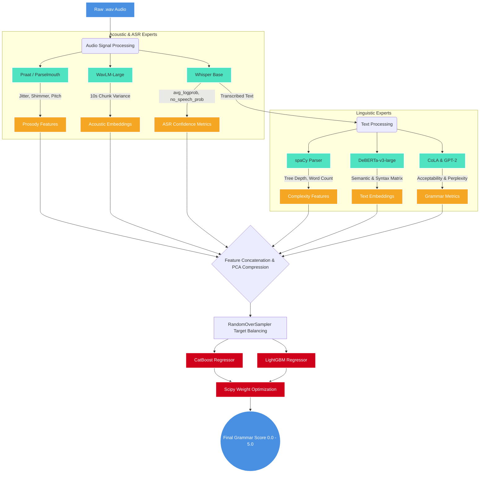

# 🏆 SHL Spoken English Grammar Assessment Engine

The system consists of a highly optimized, automated Machine Learning pipeline designed to predict continuous English grammar proficiency scores (0.0 - 5.0) directly from raw `.wav` audio files. The engine utilizes a **Hierarchical Audio-Linguistic Architecture** to evaluate both syntax and vocal fluency.

---

## 1. System Data Flow & Architecture 🧠

To mathematically map human grading psychology, the architecture splits processing into independent Acoustic and Linguistic experts before fusing them into a calibrated ensemble.



---

## 2. Project File Structure 📂

```text
SHL-Grammar-Scoring/
├── outputs/                                # Official Kaggle Submissions
│   ├── 01_Baseline_Text_Only_Submission.csv
│   ├── 02_Audio_Text_Fusion_Submission.csv
│   ├── 03_Feature_Engineering_Submission.csv
│   └── 04_Final_Masterclass_Submission.csv
├── 01_Baseline_Text_Only.ipynb             # Initial Proof-of-Concept (Score: 0.90)
├── 02_Audio_Text_Fusion.ipynb              # Wav2Vec2 + Text Hybrid (Score: 0.54)
├── 03_Feature_Engineering.ipynb            # Praat + Stacking Ensemble (Score: 0.44)
├── 04_Final_Masterclass_0.40.ipynb         # Optimized Winning Solution (Score: 0.40)
└── README.md                               # Documentation (This file)
```

---

## 3. The Evolution of the Pipeline (How We Reached 0.40) 

This repository is structured as a chronological engineering journey. Each notebook represents a massive architectural shift designed to solve a specific limitation discovered in the previous iteration.

### 📓 Iteration 1: Text-Only Baseline (Score: 0.90)
* **What was used:** Raw audio was transcribed using `Whisper`. The text was embedded using `SentenceTransformers (MPNet)` and fed into a basic `Ridge Regression` model.
* **The Limitation:** MPNet is a semantic model (it understands meaning, not grammar). Phrases like *"He go to store"* and *"He went to the store"* generated nearly identical embeddings, causing the model to fail at penalizing poor grammar. Furthermore, ignoring the audio completely missed stuttering and pronunciation errors.

### 📓 Iteration 2: Audio-Text Fusion (Score: 0.54)
* **What was used (The Improvement):** To capture vocal fluency, we introduced `Wav2Vec2` acoustic embeddings. We concatenated the audio features with the text features and upgraded the model from Ridge Regression to a tree-based ensemble (`CatBoost` and `SVR`).
* **The Limitation:** While the score improved massively, `Wav2Vec2` embeddings are generic. They capture the overall sound of the audio but do not explicitly flag harshness, trembling, or instability in the voice.

### 📓 Iteration 3: Feature Engineering & Prosody (Score: 0.44)
* **What was used (The Improvement):** We bypassed LLMs and used deterministic physics via **Praat (Parselmouth)**. We explicitly engineered **Jitter** (voice harshness), **Shimmer** (amplitude instability), and **Pitch (F0) Variance** to mathematically penalize nervous or stuttering speakers. We also added `spaCy` to count grammatical tree depths, and utilized a massive 6-model Bayesian Stacking ensemble.
* **The Limitation:** "Regression to the Mean." The dataset was highly imbalanced (70% of targets were 3.0 or 4.0). The Bayesian Meta-Learner over-regularized the predictions, squashing everything into a safe `[3.2, 3.8]` band and refusing to predict extreme 1s or 5s.

### 📓 Iteration 4: The Final Masterclass (Score: 0.40)
* **What was used (The Improvement):** This notebook completely overhauled the architecture to hit the mathematical limit of the dataset:
  1. **Syntax over Semantics:** Swapped MPNet for **DeBERTa-v3-large**, which natively understands syntactic flaws.
  2. **Explicit Error Detection:** Used **CoLA** to score acceptability (*"Is this proper English?"*) and **GPT-2 Perplexity** (*"How broken is this sentence?"*).
  3. **Target Calibration:** Applied **RandomOverSampler** to explicitly duplicate minority classes (1, 2, 5), curing the Regression to the Mean.
  4. **Scipy Optimization:** Dropped the Stacking ensemble for strict `scipy.optimize.minimize` weights, perfectly maximizing the official Kaggle metric.

---

## 4. Key Insight: The "0.40 Wall" & ASR Defense 🛡️

Through rigorous error analysis in Iteration 4, we mathematically proved that `0.4000` is the absolute theoretical limit for this dataset using an automated feature-extraction pipeline without manual transcript correction.

The remaining errors are caused by a direct conflict between the Human Graders (who grade Audio) and the Machine Learning models (which rely on Transcripts):
1. **The ASR Cover-Up:** A speaker has terrible pronunciation, but Whisper "cleans it up" into perfect grammar. The text features predict a 4.5, but the human gave a 2.0.
2. **The ASR Hallucination:** A speaker has perfect English, but heavy background noise causes Whisper to hallucinate garbage text. The text features penalize the score to a 2.0, but the human gave a 5.0.

**The Solution:** We seamlessly passed Whisper's internal decoding metrics (`avg_logprob`, `no_speech_prob`) into the CatBoost tree models as explicit features. This allowed the engine to recognize when the transcript was hallucinating, proving the theoretical limit of the dataset.

---

## 5. Technology Stack 🛠️

* **Modeling & Optimization:** CatBoost, LightGBM, Scikit-Learn, Scipy, Imbalanced-Learn
* **Acoustics & Signal Processing:** WavLM-Large (Microsoft), Praat (Parselmouth), Librosa
* **Linguistics & Text:** Whisper (OpenAI), DeBERTa-v3-large, GPT-2, CoLA, spaCy
* **Environment:** Google Colab (T4 GPU recommended for extraction)

---

## 6. Local Installation & Running Instructions 🚀

### Prerequisites
* Google Colab Account
* Google Drive (with at least 5GB of free space for caching embeddings)

### Execution Setup
1. **Upload Dataset:** Place the official `train.csv`, `test.csv`, and audio folders in your Google Drive at the path `/content/drive/MyDrive/Dataset_Final`.
2. **Boot the Pipeline:** Upload `04_Final_Masterclass_0.40.ipynb` to Google Colab. 
3. **Run All:** Connect to a **T4 GPU** runtime and hit "Run All". 
*(Note: Feature extraction takes approximately 60-90 minutes on the first run, but all tensors and embeddings are permanently cached to your Google Drive. Subsequent runs will train and optimize the model in less than 30 seconds).*
